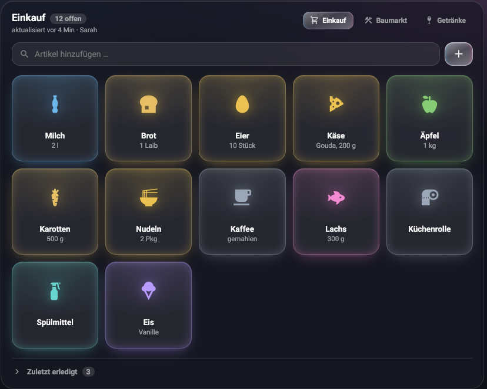

# Bring Glass Card

A frosted-glass tile view for Home Assistant todo lists — built for shopping lists, but it works with any `todo.*` entity (Bring!, Local To-do, Google Tasks, …).

Tap a tile to check an item off. Long-press it for quantity and details. Type in the field at the top to filter the list, hit Enter to add. Icons and colors come from the item name automatically, so a list of 20 items reads at a glance instead of being a wall of text.

Part of the Liquid Glass card family, alongside [liquid-glass-tile-card](https://github.com/donsebby/liquid-glass-tile-card) and [liquid-lens-navbar-card](https://github.com/donsebby/liquid-lens-navbar-card).



---

## Features

- **Tile grid** with automatic icons — 88 keyword rules covering groceries, drugstore, household, hardware and pet supplies, in German and English
- **Search built into the add field** — typing filters the visible tiles, Enter or `+` adds the text as a new item
- **No duplicates** — adding an item that already exists (including one that is already checked off) revives the existing entry instead of creating a second one
- **Quantity parsing** — `2 l milk` or `3x bread` splits into name and quantity, like the Bring app does
- **Multiple lists in one card**, switchable via tabs
- **Long-press sheet** for quantity, quick-pick chips and deleting an item
- **Theme-aware** — follows `--primary-text-color` and `--card-background-color`, so it works on light and dark themes
- **`frame: false`** for cards that already sit inside a glass container (Bubble Card popups and similar)
- **Categories** — open items are grouped into 12 sections in supermarket order (fruit & veg, bakery, dairy, …); sections collapse with a tap and remember that per device
- **Learns your categories** — pick a category in the long-press sheet to override the automatic one; the choice is stored in a Home Assistant todo list, so it applies on every device
- **German and English built in** (follows the Home Assistant language), every text can still be overridden via `labels:`

## Installation

### HACS (recommended)

1. HACS → three-dot menu → **Custom repositories**
2. Add `https://github.com/donsebby/bring-glass-card`, category **Dashboard**
3. Install **Bring Glass Card**, then reload your browser

### Manual

1. Copy `bring-glass-card.js` into `config/www/`
2. Settings → Dashboards → three-dot menu → **Resources** → add `/local/bring-glass-card.js` as **JavaScript module**

## Quick start

```yaml
type: custom:bring-glass-card
lists:
  - entity: todo.shopping_list
```

Two lists with tabs, dropped into a Bubble Card popup:

```yaml
type: custom:bring-glass-card
layout: kacheln
frame: false
lists:
  - entity: todo.groceries
    name: Groceries
    icon: mdi:cart-outline
  - entity: todo.drugstore
    name: Drugstore
    icon: mdi:bottle-tonic-outline
```

## Options

### Card

| Option | Type | Default | Description |
|---|---|---|---|
| `lists` | list | **required** | One or more entries, see below. `entity: todo.x` is accepted as shorthand for a single list. |
| `title` | string | list name | Heading. Falls back to the list's `name`, then the entity's friendly name. |
| `layout` | string | `kacheln` | `kacheln` (tiles), `kompakt` (smaller tiles), `zeilen` (rows: icon left, name right). |
| `frame` | bool | `true` | `false` removes the card's own background, border, blur and padding — use it inside another glass container. |
| `bg_opacity` | number | `0.7` | Opacity of the card background, `0`–`1`. No effect when `frame: false`. |
| `tile_radius` | number | `18` | Tile corner radius in px. |
| `tinted` | bool | `true` | Colored icons. `false` renders them in the theme's text color. |
| `glow` | bool | `true` | Tiles glow in the item color. |
| `look` | string | — (glass) | `solid` switches to calm, solid surfaces without blur or glows, see *Solid look*. Without it the card keeps the glass look. |
| `show_done` | bool | `true` | Show the "recently done" section. |
| `done_expanded` | bool | `false` | Start with that section expanded. |
| `hide_add` | bool | `false` | Hide the add/search bar. |
| `hide_hint` | bool | `false` | Hide the hint line at the bottom. |
| `refresh_seconds` | number | `120` | Fallback poll interval. Description-only edits do not change the entity state, so this keeps a wall tablet in sync. |
| `default_icon` | string | `mdi:basket-outline` | Icon for items that match no rule. |
| `icons` | map | — | Custom keyword → icon mapping, see below. |
| `qty_chips` | list | `1 pc, 2 pcs, 500 g, 1 kg, 1 l, Organic` (German: `1 Stk, 2 Stk, …, Bio`) | Quick-pick chips in the detail sheet. |
| `group_by_category` | bool | `true` | Group open items into category sections. `false` shows one flat grid. |
| `overrides_entity` | string | `todo.bring_glass_card_kategorien` | A todo list (e.g. a *Local to-do* list) that stores manual category choices: item summary = item name, description = category id. Leave it out if you don't need manual overrides. |
| `default_group` | string | `sonstiges` | Category for items that match no rule. |
| `labels` | map | HA language | Override any visible string, see below. |

### Per list

| Option | Type | Description |
|---|---|---|
| `entity` | string | **required**, must be a `todo.*` entity |
| `name` | string | Tab label and heading |
| `icon` | string | Icon shown on the tab |

### Custom icons

`icons:` is checked before the built-in rules. The key is matched as a substring against the normalized item name, so it is case- and umlaut-insensitive.

```yaml
icons:
  club mate: mdi:bottle-soda-classic
  dog food:
    icon: mdi:dog
    color: "#d9b45c"
```

### Translation

German and English are built in and follow the Home Assistant language. Every
visible string can still be overridden. `{n}` and `{list}` are placeholders.
`pcs` is the unit appended when an item is added as `3x bread`. Example (the
built-in German set, for reference):

```yaml
labels:
  title: Einkaufsliste
  add: Artikel hinzufügen …
  open: "{n} offen"
  updated_now: gerade eben aktualisiert
  updated_min: vor {n} Min aktualisiert
  updated_hour: vor {n} Std aktualisiert
  updated_day: vor {n} Tg aktualisiert
  empty_title: Alles erledigt
  empty_text: Nichts mehr offen auf dieser Liste.
  search_title: Nichts gefunden
  search_text: Mit Enter oder + als neuen Artikel anlegen.
  loading: Liste wird geladen …
  done_title: Zuletzt erledigt
  hint: Tippen = abhaken · Lang drücken = Details & Menge
  sheet_on: auf {list}
  sheet_label: Menge / Spezifikation
  sheet_placeholder: z. B. 2 Liter
  delete: Löschen
  close: Fertig
  pcs: Stück
```

## How the icons are picked

1. `icons:` from your config — first match wins
2. The built-in rule table — 88 regular expressions, checked top to bottom
3. Fallback: `default_icon`, colored from a hash of the item name so the same item always keeps the same color

Matching runs against a normalized name: lower case, `ß` folded to `ss`, diacritics stripped, punctuation collapsed to spaces. `Käse`, `Kaese` and `kase` are therefore the same to the card, and so are `Toilet paper` and `toiletpaper`.

## Notes and limitations

- The card reads items via the `todo.get_items` action wrapped in `execute_script`, so it works across HA versions with the same call shape.
- A todo entity's state is its open-item count. Changes made elsewhere (the Bring app, another dashboard) therefore show up automatically; edits that only touch a description do not change the state and are picked up by the fallback poll.
- Items are compared by name, not by id, when deduplicating on add. `Cola` and `Cola Zero` are correctly treated as different items.
- The tile grid uses `align-items: start` on purpose — with `stretch`, WebKit derives the tile width from the stretched row height and the grid stops short of the right edge.

## Solid look

`look: solid` swaps the frosted glass for quiet, solid surfaces — for dashboards that draw their own background (e.g. an animated sky) behind the cards. Lists, categories, tabs, the add field and the long-press sheet work exactly as before; only the styling changes:

- **Card panel:** solid `--surface` (default: the theme's card colour at 88 %), a hairline border, radius `--lg-radius` (20 px), 16 px padding, no blur and no shadow. `frame: false` still removes the panel.
- **Tiles:** solid `--lg-tile-bg` (default: a faint mix of the text colour), radius `--lg-radius` − 4 px (an explicit `tile_radius` still wins), no glows (whatever `glow` says). The icon sits in a 36 px circle tinted with the item colour; checked-off items are neutral and dimmed.
- **Tabs, `+`, sheet buttons:** round pills, at least 44 px tall; the active tab is a solid pill, and on narrow cards the tabs move below the title. The add field and quantity field are solid, 44 px tall. Quantity and category chips are solid, the chosen category is tinted with the item colour.
- **Text:** title 15 px, item names 15 px (13 px in `kompakt`), secondary text 13 px, counters with tabular numbers.
- `bg_opacity` has no effect in this look. Transitions are switched off for `prefers-reduced-motion`.

The card only reads these optional CSS variables, it never sets them: `--surface`, `--lg-tile-bg`, `--lg-radius`, `--primary-text-color`, `--secondary-text-color`.

```yaml
type: custom:bring-glass-card
look: solid
lists:
  - entity: todo.shopping_list
```

## Theme variables

Like the other Liquid Glass cards, this card reads two optional CSS variables, so one theme can align all of them:

```yaml
# in your Home Assistant theme
lg-radius: 22px                          # corner radius of the glass panel
lg-backdrop: blur(22px) saturate(180%)   # blur/saturation behind the panel
```

Without them nothing changes. Options set on the card itself (e.g. `blur`) still win.

## Changelog

### 1.3.0
- New option `look: solid`: calm, solid surfaces instead of glass — no blur, gradients or glows, solid tiles with the item colour in a round icon, pill buttons and 44 px tap targets (see *Solid look*). Without the option the card looks exactly as before.

### 1.2.0
- Reads the optional theme variables `--lg-radius` and `--lg-backdrop` (see *Theme variables*).
- Fixed: since 1.1.0 the card showed no texts (title, counter, hint, sheet labels), no quick-pick chips and no glass background unless every label was configured by hand. Built-in texts, chips and the card frame are back.
- German and English texts built in, following the Home Assistant language (`labels:` still overrides). Category names are translated too.
- Documents the category features from 1.1.0: `group_by_category`, `overrides_entity`, `default_group`.

## License

MIT © donsebby
